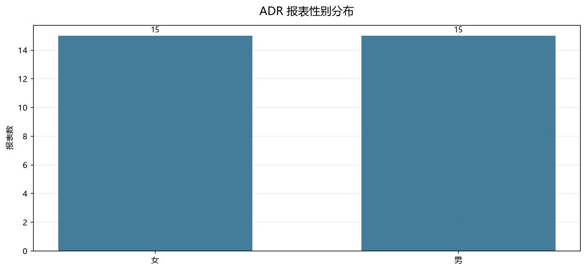
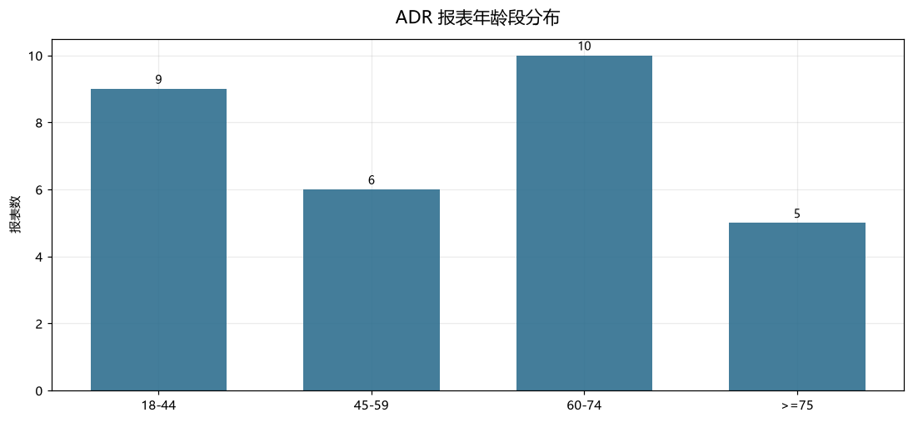
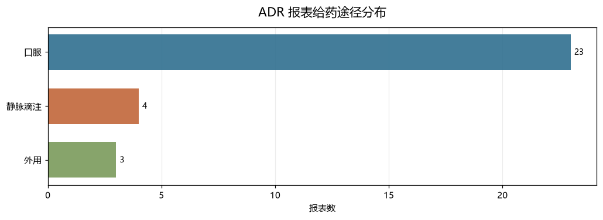
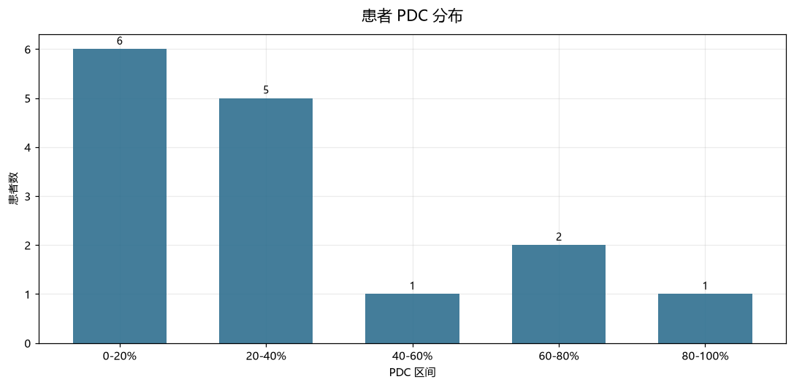
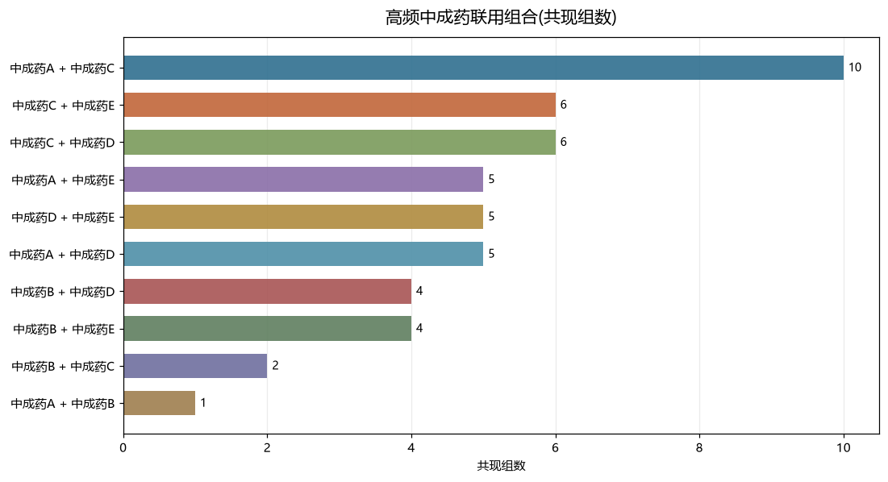
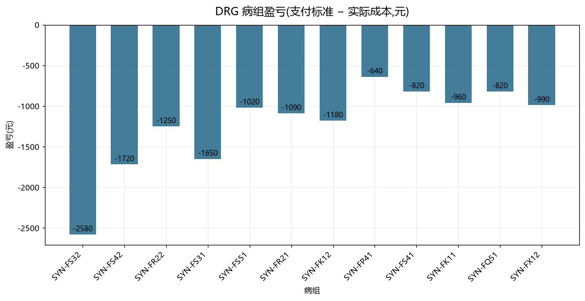

# 中医药真实世界研究(RWS)分析报告

生成时间:2026-10-04 02:20:34

> 本报告由 **中医药政策与真实世界研究工具 (TCMPolicyRWS)** 自动生成。报告中的统计量均由程序在本次运行中实时计算,政策数据来自中国政府网政策文件库的公开检索结果;RWS 数据来自使用者提供的 CSV(仓库样例为合成数据)。

## 摘要

- **ADR 分析**:30 份报表。
- **依从性分析**:15 名患者,平均 PDC 0.3317。
- **联合用药分析**:40 组,多药联用率 75.0%。
- **DRG 分析**:20 个病组,超支病组占比 85.0%。

## 二、中医药真实世界研究(RWS)分析

> **数据声明**:本部分的分析对象是使用者提供的 CSV。仓库 `examples/` 下的样例数据为**人工构造的合成数据**,已在文件头部显著标注,不对应任何真实患者。本节所有数字来自合成样例,其**唯一用途是验证代码路径与统计口径**,**不具备任何临床或流行病学含义**。

### 2.1 中药不良反应(ADR)报告特征

分析报表数 **30** 份。所有构成比的分母为报表数;品种构成比分母为品种提及次数。

**性别分布**

| 性别 | 报表数 | 占比 |
|---|---|---|
| 女 | 15 | 50.0% |
| 男 | 15 | 50.0% |

**年龄段分布**

| 年龄段 | 报表数 | 占比 |
|---|---|---|
| 18-44 | 9 | 30.0% |
| 45-59 | 6 | 20.0% |
| 60-74 | 10 | 33.33% |
| >=75 | 5 | 16.67% |

年龄(有记录者 n=30):均值 56.4 岁,中位 59.5 岁,范围 24.0–83.0 岁,≥60 岁占 **50.0%**。

**给药途径分布**

| 给药途径 | 报表数 | 占比 |
|---|---|---|
| 口服 | 23 | 76.67% |
| 静脉滴注 | 4 | 13.33% |
| 外用 | 3 | 10.0% |

**关联性评价分布**

| 关联性评价 | 报表数 | 占比 |
|---|---|---|
| 可能 | 18 | 60.0% |
| 很可能 | 12 | 40.0% |

**转归分布**

| 转归 | 报表数 | 占比 |
|---|---|---|
| 好转 | 14 | 46.67% |
| 痊愈 | 13 | 43.33% |
| 未好转 | 3 | 10.0% |

**涉及品种(按品种提及次数)**

| 品种 | 提及次数 | 占比 |
|---|---|---|
| 示例中成药A | 8 | 22.86% |
| 示例中成药C | 7 | 20.0% |
| 示例中成药E | 6 | 17.14% |
| 示例中成药D | 5 | 14.29% |
| 示例中药注射剂B | 4 | 11.43% |
| 示例中药外用制剂F | 3 | 8.57% |
| 示例中成药B | 2 | 5.71% |

品种提及总次数 35;涉及多品种的报表 5 份(16.67%)。

**给药途径 × 关联性评价 卡方检验**

| 统计量 | 值 |
|---|---|
| χ² | 3.8074 |
| 自由度 | 2 |
| p 值 | 0.149019 |
| Cramér's V | 0.3562 |
| 最小期望频数 | 1.2 |
| 期望频数<5 的格子占比 | 66.7% |
| α=0.05 下显著 | 否 |

> 检验方法:Pearson 卡方独立性检验。p 值由卡方分布上尾概率计算(scipy 可用时用 scipy,否则用正则化不完全伽马函数级数展开,精度足以支撑显著性判定)。
> **同时报告 Cramér's V 的原因**:p 值随样本量增大而系统性变小,大样本下极弱关联也会「显著」。V 提供 0–1 的关联强度度量,避免仅凭 p 值下结论。

> ⚠ 期望频数<5 的格子占 4/6,卡方近似可能不可靠,建议合并类别或改用 Fisher 精确检验。

**ADR 分析的固有局限**

- 自发呈报数据存在漏报与报告质量不均,构成比不代表真实发生率。
- 缺少暴露人群分母,无法计算发生率或相对风险。
- 关联性评价为报告人/评价人判断,不等同于因果关系。
- 本模块仅作描述性统计,不构成临床用药建议。

### 2.2 中药用药依从性(PDC / MPR / 持续性)

分析患者数 **15**。观察窗 **2024-01-05 至 2024-09-11**(251 天)。

| 指标 | 值 |
|---|---|
| 平均 PDC | 0.3317 |
| 中位 PDC | 0.239 |
| 平均 MPR(截尾) | 0.3317 |
| PDC ≥ 0.8 患者数 | 1 (6.67%) |
| 平均持续性(天) | 90.1 |
| 平均取药次数 | 3.87 |
| 存在用药间隙的患者数 | 12 |

> **指标定义**:PDC = 观察窗内被药品覆盖的**不重复天数** / 窗口天数;MPR = 窗口内供药总天数 / 窗口天数(截尾至 1)。两者差异仅在重叠处方处理:PDC 对同日多张处方只计一次,故 PDC ≤ 1 且更稳健,国际研究通常以 PDC 为首选指标。

> ⚠ **偏倚提示**:观察窗由数据推导得出(取首末取药日),而非独立设定。这会**系统性高估**依从性 —— 患者停药后的空白期被排除在窗口之外。若使用真实数据,应依据研究设计预先指定固定的观察窗。

**依从性分析的固有局限**

- PDC/MPR 依赖供药记录完整性;实际服药行为无法从处方数据观测(持有药物不等于按时服药),故为依从性的代理指标。
- 观察窗由数据推导时(见 window_derived=True)会系统性高估依从性,因为停药后的空白期被排除在窗口外。
- PDC>=80% 的阈值源自慢性病研究惯例,在中药疗程场景缺乏专门验证,仅作分组参考。
- 未考虑住院期间用药、院内调剂、自费购药等可能不在处方库中的用药。

### 2.3 中成药联合用药(合并用药)模式

分析用药记录组 **40** 组,涉及品种 **5** 个,平均每组 **1.98** 个品种。多药联用组 30 组(**75.0%**)。

**高频联用组合**

| 药品 A | 药品 B | 共现组数 | 占组比例 |
|---|---|---|---|
| 示例中成药A | 示例中成药C | 10 | 25.0% |
| 示例中成药C | 示例中成药E | 6 | 15.0% |
| 示例中成药C | 示例中成药D | 6 | 15.0% |
| 示例中成药A | 示例中成药E | 5 | 12.5% |
| 示例中成药D | 示例中成药E | 5 | 12.5% |
| 示例中成药A | 示例中成药D | 5 | 12.5% |
| 示例中成药B | 示例中成药D | 4 | 10.0% |
| 示例中成药B | 示例中成药E | 4 | 10.0% |
| 示例中成药B | 示例中成药C | 2 | 5.0% |
| 示例中成药A | 示例中成药B | 1 | 2.5% |

**高共现品种(按共现伙伴数)**

| 品种 | 出现组数 | 占组比例 | 共现伙伴数 |
|---|---|---|---|
| 示例中成药A | 18 | 45.0% | 4 |
| 示例中成药C | 17 | 42.5% | 4 |
| 示例中成药D | 17 | 42.5% | 4 |
| 示例中成药E | 16 | 40.0% | 4 |
| 示例中成药B | 11 | 27.5% | 4 |

> **关键限定**:共现频次描述的是处方层面的药品共存模式,不表示药物相互作用,也不构成联合用药合理性或安全性评价。

**联合用药分析的固有局限**

- 受处方记录完整性与拼接准确性影响,同一患者跨机构用药可能不完整。
- 共现频次高可能仅反映适应症聚集或临床路径习惯,需结合病种分层解释。
- 本分析不评估相互作用、不评价配伍合理性、不建议用药方案。

### 2.4 DRG/医保付费下中医药服务的成本结构

分析病组 **20** 个,其中 20 个具备完整权重/费率。合计实际成本 207,100.00 元,对应支付标准 188,430.00 元,差额 **-18,670.00 元**(-9.91%)。超支病组 17 个(**85.0%**)。中医类项目成本合计 62,900.00 元,占总成本 **30.37%**。

**分病组成本结构(按中医成本降序前 10)**

| 病组 | 权重 | 支付标准 | 实际成本 | 中医成本占比 | 盈亏 | 状态 |
|---|---|---|---|---|---|---|
| SYN-FS32 | 1.42 | 15,620 | 18,200 | 28.02% | -2,580 | 超支 |
| SYN-FS42 | 1.18 | 12,980 | 14,700 | 29.93% | -1,720 | 超支 |
| SYN-FR22 | 1.05 | 11,550 | 12,800 | 33.59% | -1,250 | 超支 |
| SYN-FS31 | 0.95 | 10,450 | 12,100 | 34.71% | -1,650 | 超支 |
| SYN-FS51 | 1.08 | 11,880 | 12,900 | 31.78% | -1,020 | 超支 |
| SYN-FR21 | 0.71 | 7,810 | 8,900 | 43.82% | -1,090 | 超支 |
| SYN-FK12 | 1.12 | 12,320 | 13,500 | 28.15% | -1,180 | 超支 |
| SYN-FP41 | 0.66 | 7,260 | 7,900 | 45.57% | -640 | 超支 |
| SYN-FS41 | 0.78 | 8,580 | 9,400 | 37.23% | -820 | 超支 |
| SYN-FK11 | 0.74 | 8,140 | 9,100 | 36.26% | -960 | 超支 |

**中医成本占比 与 盈亏率 的关联(描述性)**

| 统计量 | 值 |
|---|---|
| Pearson r | -0.0715 |
| r² | 0.0051 |
| p 值(近似) | 0.7611 |
| n | 20 |

> 该相关系数仅描述本样本内「中医项目成本占比」与「盈亏率」的线性共变,不能解释为因果:病种、病情复杂度、收治结构等混杂因素未受控。

> p 值计算方法:Pearson r;双尾 p 由 t^2 ~ chi2(1) 近似。

**盈亏平衡费率(成本等于支付时的费率)**

| 病组 | 当前费率 | 盈亏平衡费率 | 费率缺口 |
|---|---|---|---|
| SYN-FS32 | 11,000 | 12,817 | 1,817 |
| SYN-FS31 | 11,000 | 12,737 | 1,737 |
| SYN-FR21 | 11,000 | 12,535 | 1,535 |
| SYN-FZ32 | 11,000 | 12,519 | 1,519 |
| SYN-FS42 | 11,000 | 12,458 | 1,458 |
| SYN-FQ51 | 11,000 | 12,414 | 1,414 |
| SYN-FK11 | 11,000 | 12,297 | 1,297 |
| SYN-FR22 | 11,000 | 12,190 | 1,190 |
| SYN-FX12 | 11,000 | 12,088 | 1,088 |
| SYN-FK12 | 11,000 | 12,054 | 1,054 |

**DRG 分析的固有局限**

- 支付标准以当地医保部门正式文件为准,本模块基于使用者提供的权重与费率做算术推算,不可用于实际结算。
- 成本口径(是否含人力、折旧、药品耗材)显著影响结论,须与实际核算制度对齐后解读。
- 病种层面汇总掩盖了病例组合差异,结论不适用于个体病例。
- 本模块不评价支付政策合理性,不构成医保或临床建议。

## 三、数据来源与方法

### 3.1 政策数据

- **来源**:中国政府网政策文件库公开检索接口 `sousuo.www.gov.cn/search-gov/data`,检索范围覆盖国务院文件(`zhengcelibrary_gw`)与部门文件(`zhengcelibrary_bm`)。
- **检索策略**:按**标题**匹配中医药相关关键词(中医药、中药、中医、经典名方、中药饮片、中西医结合、中成药、民族药等)。限定标题匹配可显著降低噪音 —— 全文匹配常因附件表格偶现「中药」二字而引入大量非政策域文件。
- **存储**:SQLite,正文与元数据分表;FTS5 `trigram` 分词器建全文索引。
- **未访问的站点**:`nmpa.gov.cn`、`cde.org.cn`、`nhc.gov.cn` 部署了 JavaScript 反爬(返回 412/202)。本工具**不尝试绕过**此类访问控制,因此 NMPA/CDE/NHC 的原始文件未纳入语料。

### 3.2 RWS 数据

- 分析对象为使用者提供的 CSV,表结构见 README。
- 仓库内 `examples/` 样例为**合成数据**,文件头部均带显著声明,仅用于验证代码路径,**不可作为临床或流行病学证据**。
- 本工具不采集、不推断真实患者数据;运行时无需任何真实患者数据即可完整跑通演示流程。

### 3.3 图表渲染

- 本次运行的渲染后端:**matplotlib (CJK 字体: Microsoft YaHei)**。
- 中文字体处理:matplotlib 默认字体不含 CJK 字形,中文标签会渲染为方块。本工具按优先级探测系统中文字体(微软雅黑 / 黑体 / 等线 / 宋体),并**实际渲染中文字符验证无缺字**后才采用;全部不可用时自动回退为**手写 SVG**(SVG 由浏览器渲染文本,不存在缺字问题)。

## 四、总体局限与免责声明

1. **政策语料不等于政策全集**。语料来自单一公开文件库的标题检索,未覆盖地方性文件、未被收录的文件,以及标题不含关键词的文件。文件库的电子化回溯覆盖不均,早期年份计数系统性偏低。
2. **年度计数差异不等于政策强度差异**。本工具的断点检测是描述性的,不构成因果推断。
3. **主题归类依赖规则**。`THEME_RULES` 的边界直接决定主题占比,规则是公开可复核的,但不同规则会得出不同分布。
4. **RWS 结论受数据来源限制**。自发呈报数据存在漏报;处方数据无法观测实际服药行为;两者都不能计算真实发生率。
5. **合成数据不具备实证含义**。仓库样例数据的任何「结果」只反映代码逻辑,不得引用为研究发现。
6. **本工具不提供临床建议、不作为医保结算依据、不构成法律意见**。支付标准、用药决策须以官方文件与有资质人员的判断为准。
7. **本文档不构成对任何政策条文的解释**。政策原文以发布机关正式文本为准。
